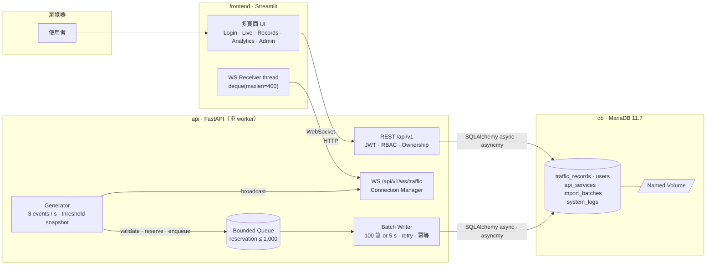

# API Traffic Monitoring — 系統架構

- 版本：1.0（2026-10-31）
- 決策紀錄：[ADR-001 Ingestion Buffer](decisions/001-ingestion-buffer.md)、[ADR-002 Auth / RBAC](decisions/002-authentication-rbac.md)、[ADR-003 Real-time Delivery](decisions/003-realtime-delivery.md)
- 其他：[開發計畫](plan.md)、[測試計畫](testing.md)、[Scaling Roadmap](scaling-roadmap.md)、[CLAUDE.md](../CLAUDE.md)

## 1. 目的與範圍

系統模擬三個 API Service（Auth、Orders、Payment）每秒的 Request Count，提供：使用者認證與角色權限、資料 CRUD 與 CSV / JSON 批量匯入、WebSocket 即時監看與異常標記、歷史統計與 Excel 匯出、Admin 系統管理。

設計優先序：Correctness → Reliability → Maintainability → Scalability。架構是單實例 Modular Monolith。對 take-home assessment 來說，一個行為可以被完整驗證的單實例，比一個沒有證據的分散式系統有價值；水平擴充的觸發條件與路徑見 Roadmap。

## 2. 技術基線

| 層次 | 選擇 | 邊界 |
|---|---|---|
| Backend | Python 3.12、FastAPI、Pydantic v2 | REST、WebSocket、背景任務 |
| Frontend | Streamlit（多頁面） | 只透過 REST / WebSocket 存取資料，不連 DB |
| Database | MariaDB 11.7 | Named Volume 持久化 |
| ORM / Driver | SQLAlchemy 2.x async、asyncmy | `create_async_engine`；所有業務查詢用 ORM / expression，禁止原生 SQL |
| Migration | Alembic | API 容器啟動時 `alembic upgrade head`，完成後才啟動 uvicorn |
| Auth | JWT（HS256）、Argon2id | Backend 驗證與授權；前端不做授權判斷 |
| Analytics / Export | SQLAlchemy 聚合、pandas、openpyxl | 聚合在 DB 做；匯出上限 50,000 列 |
| Test | pytest、pytest-asyncio、httpx | 針對 compose 內的真實 MariaDB；測試庫 `traffic_test` 由 `db/init/01-create-test-db.sh` 在 volume 首次初始化時建立並授權 |
| Deployment | Docker multi-stage、Docker Compose | `api`、`frontend`、`db` 三個 service |

連線池：`pool_size=5`、`max_overflow=10`、`pool_pre_ping=True`、`pool_recycle=1800`（低於 MariaDB 預設 `wait_timeout` 28800，避免拿到被 server 關掉的連線）。

API 固定單一 uvicorn worker。Generator、Queue、Connection Manager 都是 process 內狀態，多 worker 會讓它們各自複製一份；需要擴充時走 Roadmap 的路徑，不是加 worker。

## 3. 架構圖與資料路徑



**Simulator 路徑（Real-time First）**：`Generate → Validate / Threshold snapshot → Reserve capacity → Enqueue → Broadcast`。Writer 從 Queue 取批次寫入 MariaDB；Broadcast 不等待 commit。因此即時畫面可能先於歷史查詢出現事件，正常情況落差約一個 flush interval。細節見 ADR-001、ADR-003。

```mermaid
sequenceDiagram
  participant G as Generator
  participant B as Buffer (semaphore + queue)
  participant M as Connection Manager
  participant W as Batch Writer
  participant D as MariaDB
  loop 每秒
    G->>G: 產生 auth / orders / payment 三筆，套用 threshold snapshot
    G->>B: reserve() → enqueue(event)
    B-->>G: accepted
    G->>M: broadcast(event)
    M-->>M: 寫入各連線的 per-connection queue
  end
  loop 滿 100 筆或 5 秒
    W->>B: 取出批次（仍占容量）
    W->>D: BEGIN; add_all(batch); COMMIT
    alt 成功
      D-->>W: ok
      W->>B: release(len(batch))
    else IntegrityError（commit 成功但 ack 遺失）
      W->>D: rollback; 查已存在 event_id; 只補缺的; COMMIT
      W->>B: release(len(batch))
    else 連線錯誤
      W->>W: rollback; 退避重試（≤ 30 s），批次保留
    end
  end
```

**Manual / Import 路徑**：`REST → JWT / RBAC → Validation → Service → ORM transaction → Commit → Response`。成功回覆的前提是 commit 成功；不經過記憶體 Queue，也不廣播到 WebSocket。

## 4. 分層與責任

| 層 | 責任 | 不做 |
|---|---|---|
| `api/`（routers） | request / response schema、JWT 解析、role dependency、錯誤轉換 | 業務規則 |
| `services/` | Ownership 判斷、Threshold snapshot、交易協調、稽核寫入 | 開啟無界背景任務 |
| `repositories/` | SQLAlchemy ORM 查詢與寫入 | HTTP / UI 狀態 |
| `realtime/` | Generator、Connection Manager、Broadcast | 承諾資料已落盤 |
| `ingestion/` | 容量 reservation、Queue、Batch Writer、Retry | 靜默丟棄資料 |
| `frontend/` | Streamlit 頁面、session state、WS receiver | 直連 DB、決定權限 |

每個 HTTP request、每次 Writer transaction、每個背景任務各自持有一個 `AsyncSession`，明確 commit / rollback / close；不跨 task 共用。

## 5. Domain Model

一筆 `TrafficRecord` 是某 Service 在一秒區間內的 Request Count：`value` 為非負整數，不是延遲、百分比或累積 counter。內部與 DB 一律 UTC；API 收發含 timezone 的 ISO 8601；naive datetime 回 422，不依主機時區猜。

MariaDB 的 `DATETIME` 不保存時區，`TIMESTAMP` 又會隨 session time zone 轉換，所以不用 SQLAlchemy 的 `DateTime(timezone=True)` 假裝有時區——在 MariaDB dialect 上它沒有實際效果，asyncmy 讀回來是 naive datetime。所有時間欄位改用自訂 `UTCDateTime` TypeDecorator（底層 `DATETIME(6)`）：bind 時 aware → naive UTC，result 時 naive → `tzinfo=UTC`，naive 輸入到 type 層直接 raise。engine `connect_args` 設 `init_command="SET time_zone='+00:00'"`：這是 driver 的連線參數，pool 每開一條實體連線都會執行，不是 startup 跑一次；若 asyncmy 版本不支援，改用 `event.listens_for(engine.sync_engine, "connect")`。兩層責任不同——TypeDecorator 管 Python aware ↔ DB naive UTC 的轉換，`SET time_zone` 管 session 語意（`TIMESTAMP`、`NOW()`）；應用程式不用 `TIMESTAMP` 欄位也不在 SQL 裡取 `NOW()`，所以後者是保險。round-trip 測試見 [testing.md](testing.md) TZ-01：比較的是同一時間點，不是 tzinfo 有沒有。

| Service | slug | 基準分布 | Spike | Threshold |
|---|---|---|---|---:|
| Auth API | `auth` | N(60, 10) | 5% 機率 ×1.8 | 80 |
| Orders API | `orders` | N(120, 15) | 5% 機率 ×1.8 | 150 |
| Payment API | `payment` | N(60, 10) | 5% 機率 ×1.8 | 80 |

Generator 每秒各產生一筆，負值截為 0，random seed 由 `SIMULATOR_SEED` 控制，異常可重現。

### 5.1 資料表

| 表 | 欄位 | 約束 |
|---|---|---|
| `users` | id, email, password_hash, role, is_active, created_at | `email` unique；role ∈ {ADMIN, USER, VIEWER}；只存 Argon2 hash |
| `api_services` | id, slug, display_name, alert_threshold, is_active, updated_at | `slug` unique；threshold 非負整數 |
| `traffic_records` | id, event_id, service_id, title, value, source, created_by, observed_at, persisted_at, threshold_applied, is_anomaly, import_batch_id | `event_id` CHAR(36) unique；`service_id` FK；`value ≥ 0`；`created_by`、`import_batch_id` nullable |
| `import_batches` | id, filename, uploaded_by, status, total_count, success_count, failure_count, errors, created_at | status ∈ {SUCCEEDED, FAILED}；All-or-Nothing，所以 success_count 為 0 或 total_count |
| `system_logs` | id, level, event_type, actor_id, target_type, target_id, message, context, request_id, created_at | 業務稽核事件；不存憑證、token、完整 payload |

索引：`unique(event_id)`、`unique(email)`、`unique(slug)`、`(service_id, observed_at)`、`(source, observed_at)`、`(created_by)`。PK 為 BIGINT auto-increment。

### 5.2 欄位來源與語意

- `source` ∈ {MANUAL, IMPORT, SIMULATOR}，由 Backend 設定。
- `created_by`：MANUAL / IMPORT 為操作者 id；SIMULATOR 為 NULL。NULL 不屬於任何 USER，只有 ADMIN 可改刪。
- `threshold_applied`、`is_anomaly` 在事件進入系統時 snapshot；之後改 threshold 不回寫歷史。
- Owner / Admin 修改歷史 `value` 時，以該筆原本的 `threshold_applied` 重算 `is_anomaly`，並寫稽核。
- `persisted_at` 由應用程式在 flush 時設定（commit 前），是近似值，不是 DB commit 時間戳。
- Create / Update / Read 使用不同 Pydantic schema，`extra="forbid"`；request 出現 `source`、`created_by`、`is_anomaly`、`threshold_applied`、`persisted_at`、`import_batch_id` 即 422。

### 5.3 Import

CSV / JSON 採 All-or-Nothing：先驗證所有列（欄位、Service slug、timezone、非負整數、event_id 格式與檔內重複），再以單一 transaction 寫入；任一列錯誤回報行號與原因，`traffic_records` 不新增任何資料。限制：10,000 列、5 MB。`event_id` 欄位可空，空值由 Backend 產生 UUID；若與既有資料重複，整批 409。`import_batches` 在資料 transaction 之後以獨立 transaction 寫入結果（成功或失敗都記）。

CSV 欄位：`event_id,service_slug,title,value,observed_at`；JSON 為同欄位的物件陣列。範例見 `data/sample_traffic.csv`、`data/sample_traffic.json`。

## 6. API Contract

所有業務路徑前綴 `/api/v1`。Swagger UI：`/docs`；OpenAPI JSON：`/openapi.json`。

| 資源 | Endpoint | 權限 |
|---|---|---|
| Auth | `POST /auth/register`、`POST /auth/token`、`GET /auth/me` | 公開 / 公開 / 已登入 |
| Records | `GET /records`、`GET /records/{id}` | 全角色 |
| Records | `POST /records`、`POST /records/bulk` | ADMIN、USER |
| Records | `PATCH /records/{id}`、`DELETE /records/{id}` | Owner 或 ADMIN |
| Imports | `POST /imports`（multipart）、`GET /imports/{id}` | ADMIN、USER |
| Services | `GET /services` | 全角色 |
| Services | `PATCH /services/{id}` | ADMIN |
| Analytics | `GET /analytics/summary`、`/categories`、`/trends`、`/export` | 全角色 |
| Admin | `GET /admin/users`、`PATCH /admin/users/{id}` | ADMIN |
| Admin | `GET /admin/logs`、`GET /admin/system` | ADMIN |
| Health | `GET /health/live`、`GET /health/ready` | 公開 |
| Realtime | `WS /api/v1/ws/traffic` | 全角色（JWT） |

**列表參數**：`page`（1–10,000）、`page_size`（1–100，預設 20）、`sort`（allowlist：`observed_at`、`value`、`persisted_at`；前綴 `-` 為 desc；預設 `-observed_at`；一律加 `id` 作穩定次排序）。Filter：`service`（slug）、`source`、`is_anomaly`、`start`、`end`（`start <= observed_at < end`；`start > end` 回 422）、`q`（title 模糊）。回覆：

```json
{"items": [], "page": 1, "page_size": 20, "total": 0}
```

**Bulk**：`POST /records/bulk` 最多 1,000 筆，超過回 422。

**錯誤格式**：

```json
{"error": {"code": "FORBIDDEN", "message": "Only the owner or an admin can modify this record.", "request_id": "c0ffee…"}}
```

| HTTP | code |
|---|---|
| 401 | `UNAUTHORIZED`、`TOKEN_EXPIRED` |
| 403 | `FORBIDDEN` |
| 404 | `NOT_FOUND`（不存在與無權查看皆回 404，不洩漏存在性） |
| 409 | `CONFLICT`（email / event_id 重複） |
| 422 | `VALIDATION_ERROR`（含欄位路徑；匯入含行號） |
| 503 | `SERVICE_UNAVAILABLE`（DB 不可用、Writer 停止） |

每個 request 帶 `X-Request-ID`（沒有就產生），回覆原樣帶回，application log 與 `system_logs` 一併記錄。DB exception 訊息、密碼、token 不出現在任何 response。

## 7. Analytics 與 Streamlit

Analytics 一律在 DB 聚合（`select(func.count(), func.sum(), func.avg(), func.min(), func.max())`），pandas 只整理結果，不載入全表。

- `summary`：count、sum、avg、min、max、anomaly_count；接受與列表相同的 filter。
- `categories`：依 Service 聚合同一組指標。
- `trends`：`bucket=minute|hour`，每個 bucket 的 count / sum / avg / max / anomaly_count；沒有資料的 bucket 不補零。
- `export`：套用相同 filter 的明細 Excel（openpyxl），上限 50,000 列，超過回 422 要求縮小範圍。

單一 Service 的 `avg(value)` 是已觀測一秒樣本的平均 RPS。混合多個 Service 的 avg 是「每筆 Service-second 觀測的平均」，UI 以此標示，不標成整體 RPS。

| Streamlit 頁面 | 內容 |
|---|---|
| Login | 登入 / 登出、token 過期提示 |
| Live Monitor | 三條折線（近 120 秒）、即時柱狀圖、異常標記、連線狀態、最後事件時間、系統狀態 |
| Records | 分頁 / 篩選 / 排序列表、新增 / 編輯 / 刪除（依角色顯示）、CSV / JSON 匯入與結果 |
| Analytics | KPI、時間區間、Service 聚合、趨勢圖、Excel 下載 |
| Admin | 使用者與角色、Threshold、系統狀態（buffer / pool / health）、系統日誌、歷史查詢 |

Session state 保存 token、使用者資訊、receiver 狀態；每個 session 最多一個 WS receiver，rerun 不重建。Receiver 是 daemon thread，只 append 到有同步保護的 `deque`，不碰 `st.session_state` 或任何 `st.*` API——Streamlit 只保證 script thread 可以安全使用這些；`st.session_state` 只由 script thread 讀寫。Streamlit 沒有可靠的 session 結束 hook，使用者直接關分頁時 thread 會殘留到 token 到期或 server 關閉連線為止，server 端 `WS_MAX_CONNECTIONS` 兜底。Live Monitor 標示「即時（尚未持久化）」，不讓使用者把 live 事件當成已落盤。UI 隱藏按鈕只是體驗，不是授權；所有權限由 Backend 判定。

## 8. Static Threshold

異常條件 `value > alert_threshold`（嚴格大於）：threshold 80 時 79、80 正常，81 異常。Admin 透過 `PATCH /services/{id}` 修改；Generator 每 5 秒重新載入，DB 不可用時沿用最後一次成功載入的值，`/admin/system` 顯示最後載入時間。冷啟動尚未載入前 Generator 不產生事件、readiness 為 false。

不做 dynamic threshold、通知、去重或規則引擎。

## 9. 部署、健康與停止

Compose：`db` 有 healthcheck（`healthcheck.sh --connect --innodb_initialized`），並掛載 `db/init/` 到 `/docker-entrypoint-initdb.d/`——官方 image 只會建立 `MARIADB_DATABASE` 一個庫並授權，測試用的 `traffic_test` 由 `01-create-test-db.sh` 在 volume 首次初始化時建立；`api` 以 `depends_on: condition: service_healthy` 等待，entrypoint 依序執行 `alembic upgrade head` → bootstrap admin → seed（若 `SEED_DEMO_DATA=true`）→ uvicorn；`frontend` 等待 `api` healthy。Backend / Frontend 皆為 multi-stage Dockerfile：builder stage 安裝依賴，runtime stage 只複製虛擬環境與程式碼，以非 root 使用者執行。

| 狀態 | 條件 | `/health/ready` |
|---|---|---|
| HEALTHY | DB 可用、Generator / Writer 存活、無 retry 中批次 | 200 |
| DEGRADED | DB 暫時不可用或 Writer 在 retry；buffer 未滿 | 503（需認證的 REST 全部無法服務，所以不算 ready；body 仍是完整 JSON） |
| UNAVAILABLE | 初始化失敗、Writer 停止、buffer 滿且無法寫入（Writer 在 retry，或已超過 2 個 flush interval 沒有 commit） | 503 |

`/health/ready` 不需要認證，不論狀態碼都回同一份 JSON body，帶 `state` 與 ingestion 計數：`queued`、`in_flight`、`retry_pending`、`total_uncommitted`、`oldest_pending_age_s`、`last_commit_at`、`writer_state`、`active_connections`。每個計數都是在事件所在之處直接讀取：`in_flight` 是 Writer 手上的批次（收集中、寫入中，或永久錯誤後保留在記憶體的那一批，此時 `writer_state=UNAVAILABLE`），`retry_pending` 只在退避（`RETRY_WAIT`）期間非零。這些是營運計數不是敏感資料。放在這裡而不是只放 `/admin/system` 的原因：授權每個 request 都查 DB（ADR-002），DB 故障時 `/admin/system` 本身會 503，而那正是最需要看 buffer 水位的時候。`/admin/system` 在這些之上多給 pool 狀態（`engine.pool.status()`）、threshold 最後載入時間、各表筆數。

把 readiness 與指標放在同一個端點是 MVP 的刻意簡化：若部署在會把 not-ready 實例移出的 load balancer 後面，這條診斷路徑會跟著不可達，production 應把指標拆到獨立的 `/metrics`（Roadmap 階段 1）。

`/health/live` 只檢查 process 與 event loop。Docker healthcheck 打 `/health/live` 而不是 `/health/ready`——uvicorn 在 migration 完成後才啟動，所以 live 成立就代表可以讓 `frontend` 啟動；而 DB 故障不會讓 container 被判 unhealthy、被編排器處置而丟掉 Queue。

正常停止：停 Generator → Writer 在 10 秒內 flush 剩餘批次 → 關閉 WS 連線 → `engine.dispose()`。timeout 或 kill 時未 commit 的事件遺失，這是 MVP 已接受的邊界（ADR-001）。

## 10. 日誌與稽核

兩條分開的線：

- **Application log**：stdout、JSON 一行一筆（timestamp、level、logger、request_id、message、extra），由 Docker 收。不寫進 DB，所以 DB 故障時不會出現「寫 log 說 DB 壞了但 log 要寫進 DB」的遞迴。
- **`system_logs`（稽核）**：只記業務事件——登入成功 / 失敗、註冊、角色或停用變更、threshold 變更、匯入結果、record 刪除、Writer 從 retry 恢復、永久錯誤。與觸發它的業務操作同一個 transaction 寫入；Writer 事件用獨立 session、best-effort。`GET /admin/logs` 查的是這張表，支援 level / event_type / 時間區間 filter 與分頁。

密碼、token、DB credential 不進任何一條線。
